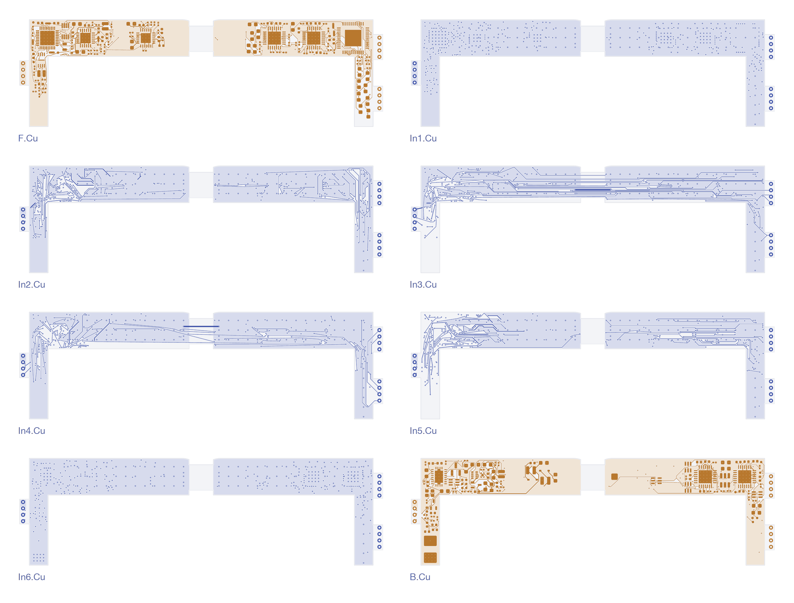
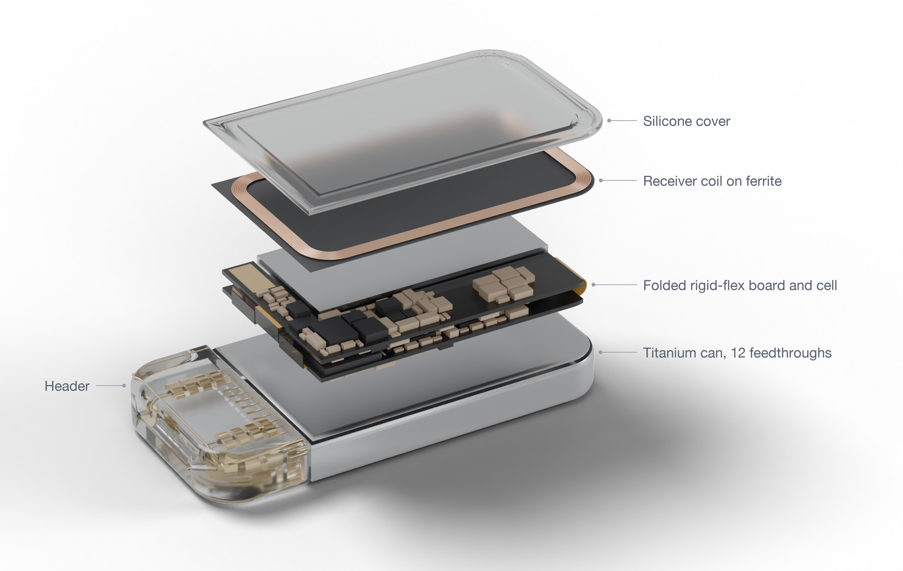
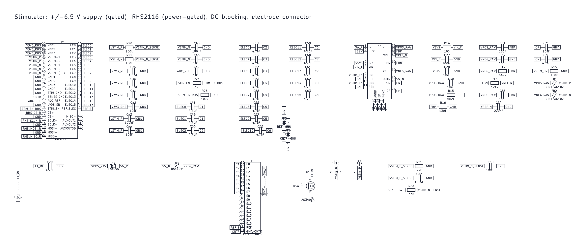

# RESPNS Boards

Circuit boards for RESPNS, a closed-loop responsive neurostimulator in the class of the NeuroPace RNS, built from off-the-shelf chips only. The bench board is for lab bring-up; the implant board carries the same circuit folded into a 28 × 60 × 7.7 mm titanium can.

| | Bench | Implant |
|---|---|---|
| Stackup | 6-layer FR4, 1.6 mm | 8-layer HDI rigid-flex, 0.6 mm |
| Size | 90 × 60 mm | 90.5 × 26.8 mm flat, two L-shaped panels |
| Chips | EFR32BG22, 4 × MAX30003, RHS2116, nPM1100, BQ51013B | Same netlist |
| Routing | In progress | Complete, 1,088 vias |
| Checks | ERC 0 errors | DRC 0 violations, 0 unconnected |

Research prototype for bench and animal work. Not for human use.

## Layout

Implant board, top and bottom.

Implant copper, F.Cu to B.Cu; the flex hinge carries In3 and In4 only.

## Package

The folded board and cell sit in the titanium can; the receiver coil sits on ferrite outside the can, under the silicone cover.

Section through the folded board stack in the 6.8 mm can.

## Schematics

Power, stimulator, sensing, MCU and safety sheets

Power, charging-heat and bring-up studies: [RESPNS-Studies](https://github.com/VerifyHalo/RESPNS-Studies).
