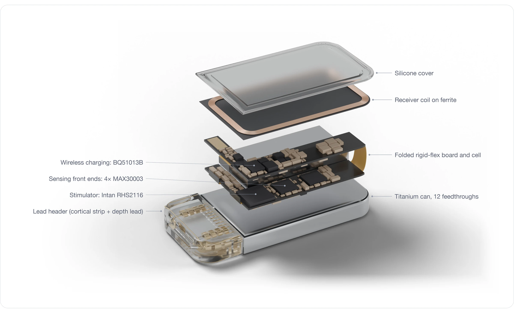
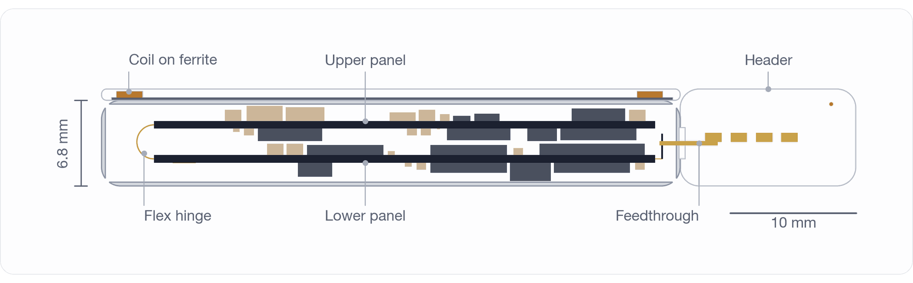
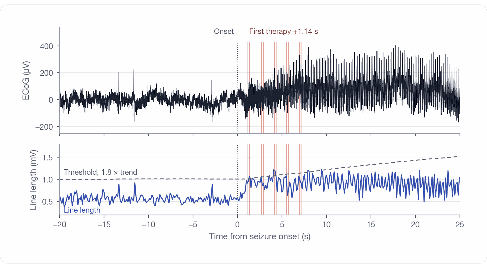
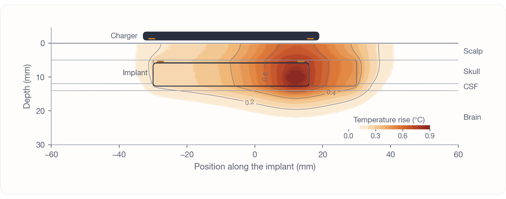
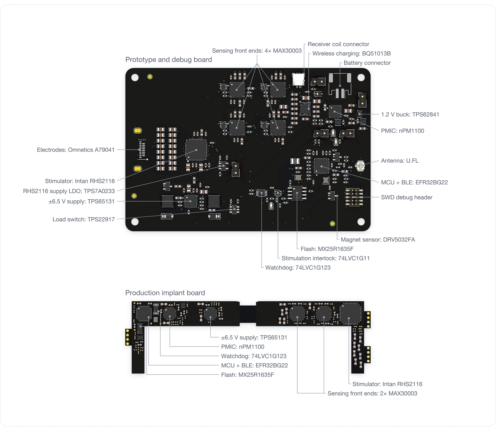

# RESPonsive Neuro Stimulator

This repo demos work from our private repositories.

We (re)designed an epilepsy implant in the class of NeuroPace's RNS from catalog chips, with prototype boards at about $600 in parts.

### Background 

About 50 million people live with epilepsy, and 1 in 3 do not respond to medication. For many of them, the most advanced option is responsive neurostimulation: a real-time "surgeon" in the skull that listens to the brain (tissue), catches a seizure as it starts, and disrupts it with a short burst of stimulation. NeuroPace's RNS System, designed in the early 2000s and approved by the FDA in 2013, is still the only one, at about $37,000 for the system. It runs on a sealed, non-rechargeable cell; today's low-power chips and wireless charging make a redesign possible. In the long-term trial, patients had a median of 75% fewer seizures after 9 years.

Note that responsive neurostimulation (RNS) systems must be fully implanted because percutaneous components pose an infection risk, while emerging non-invasive data acquisition systems cannot match the signal quality of invasive techniques. So the battery is sealed in and every microamp counts. That is why devices like this have relied on custom chips.

### Redesign

Research prototype for bench and animal work. Not for human use.

Copyright © 2026 Anton Melnychuk. Licensed under the CERN Open Hardware Licence v2, Strongly Reciprocal (CERN-OHL-S-2.0); see LICENSE.
