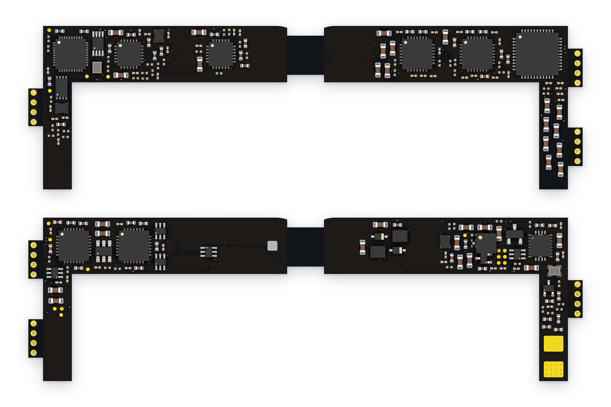
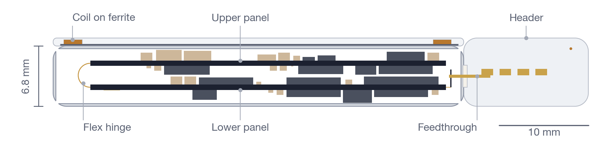
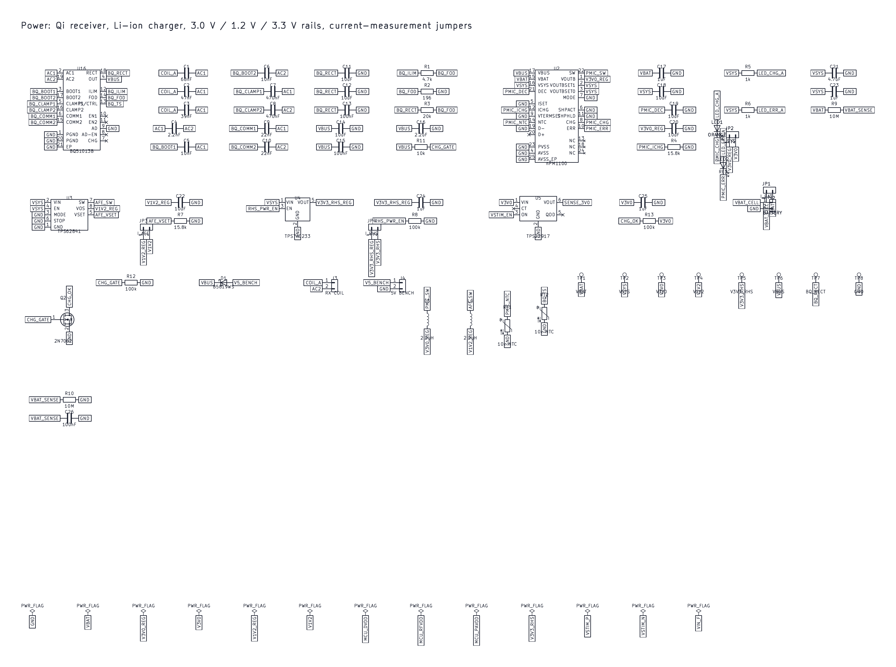

# RESPNS Boards

We designed an epilepsy implant in the class of NeuroPace's RNS from catalog chips, for [X]x less. No custom ASIC.

About 50 million people live with epilepsy, and 1 in 3 do not respond to medication. For many of them, the most advanced option is responsive neurostimulation: an implant in the skull that listens to the brain, catches a seizure as it starts, and disrupts it with a short burst of stimulation. NeuroPace's RNS System, approved by the FDA in 2013, is still the only one, at [$XXk] per device. In the long-term trial, patients had a median of 75% fewer seizures after 9 years.

It must be fully implanted, because anything through the skin is an infection risk. So the battery is sealed in and every microamp counts. That is why devices like this have relied on custom chips.

Circuit boards for RESPNS, a closed-loop responsive neurostimulator in the class of the NeuroPace RNS, built from off-the-shelf chips only. The bench board is for lab bring-up; the implant board carries the same circuit folded into a 28 × 60 × 7.7 mm titanium can.

| | Bench | Implant |
|---|---|---|
| Stackup | 6-layer FR4, 1.6 mm | 8-layer HDI rigid-flex, 0.6 mm |
| Size | 90 × 60 mm | 90.5 × 26.8 mm flat, two L-shaped panels |
| Chips | EFR32BG22, 4 × MAX30003, RHS2116, nPM1100, BQ51013B | Same netlist |
| Routing | In progress | Complete, 1,088 vias |
| Checks | ERC 0 errors | DRC 0 violations, 0 unconnected |

Research prototype for bench and animal work. Not for human use.

## Layout

Implant board, top and bottom.

Implant copper, F.Cu to B.Cu; the flex hinge carries In3 and In4 only.

## Package

Section through the folded board stack in the 6.8 mm can, with the receiver coil on ferrite under the silicone cover.

## Schematics

Power, stimulator, sensing, MCU and safety sheets

Power, charging-heat and bring-up studies: [RESPNS-Studies](https://github.com/VerifyHalo/RESPNS-Studies).
