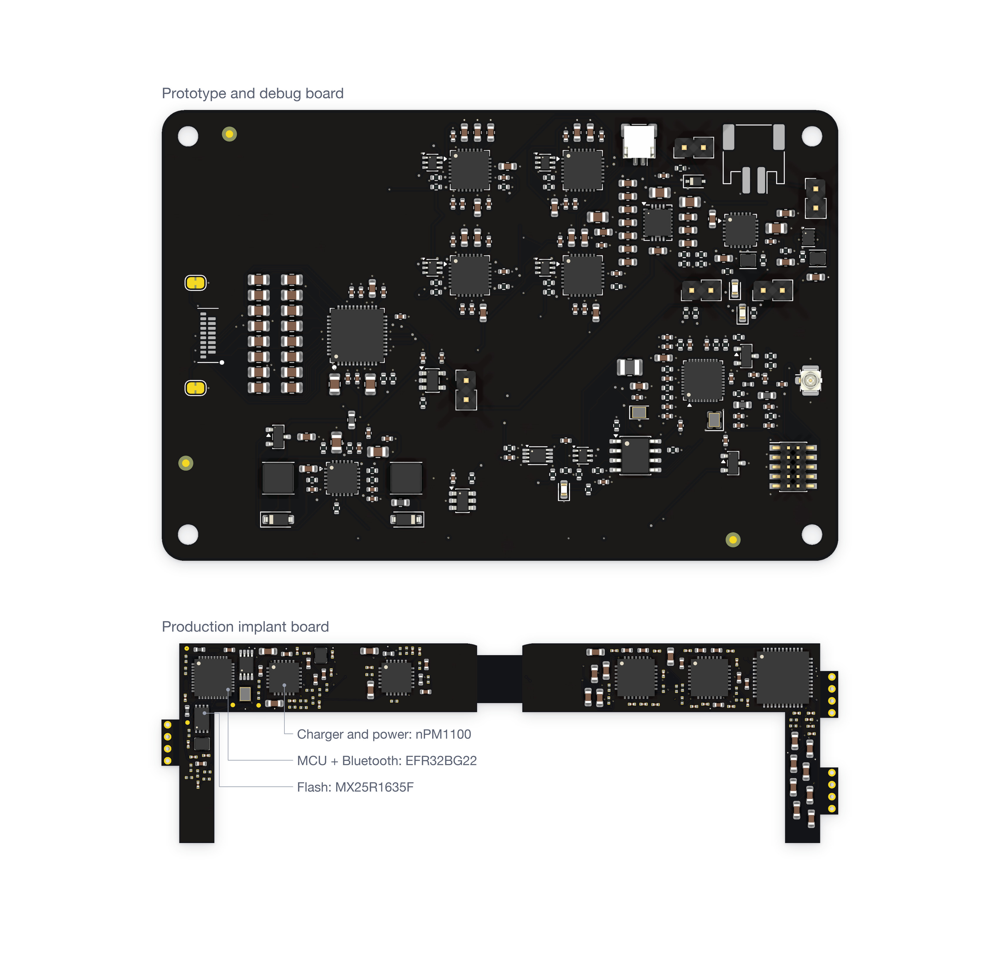
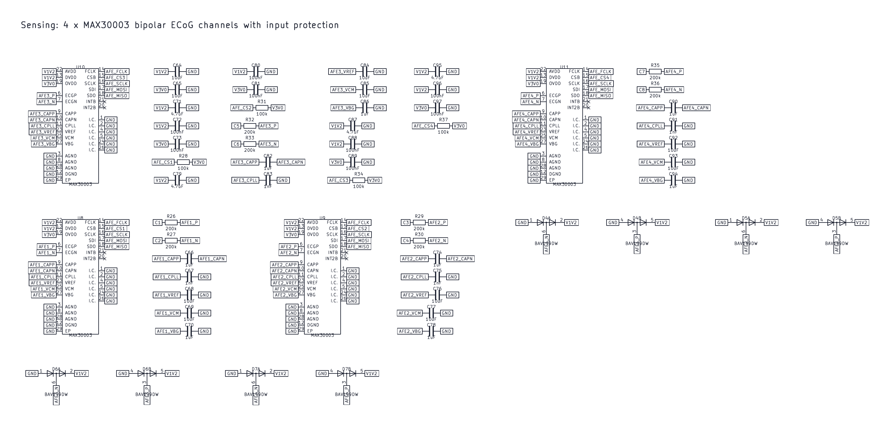
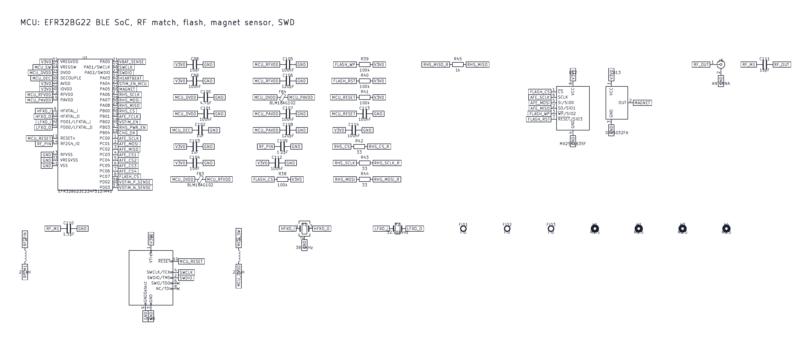
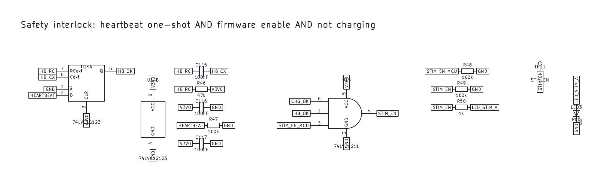

# RESPNS: RESponsive Neuro Stimulator

Research prototype for bench and animal work. Not for human use.

We designed an epilepsy implant in the class of NeuroPace's RNS from catalog chips, with prototype boards at about $600 in parts.

About 50 million people live with epilepsy, and 1 in 3 do not respond to medication. For many of them, the most advanced option is responsive neurostimulation: a real-time "surgeon" in the skull that listens to the brain (tissue), catches a seizure as it starts, and disrupts it with a short burst of stimulation. NeuroPace's RNS System, designed in the early 2000s and approved by the FDA in 2013, is still the only one, at about $37,000 for the system. It runs on a sealed, non-rechargeable cell; today's low-power chips and wireless charging make a redesign possible. In the long-term trial, patients had a median of 75% fewer seizures after 9 years.

Note that responsive neurostimulation (RNS) systems must be fully implanted because percutaneous components pose an infection risk, while emerging non-invasive data acquisition systems cannot match the signal quality of invasive techniques. So the battery is sealed in and every microamp counts. That is why devices like this have relied on custom chips.

The bench board is for lab bring-up; the implant board carries the same circuit folded into a 28 × 60 × 7.7 mm titanium can.

| | Bench | Implant |
|---|---|---|
| Stackup | 6-layer FR4, 1.6 mm | 8-layer HDI rigid-flex, 0.6 mm |
| Size | 90 × 60 mm | 90.5 × 26.8 mm flat, two L-shaped panels |
| Chips | EFR32BG22, 4 × MAX30003, RHS2116, nPM1100, BQ51013B | Same netlist |
| Routing | In progress | Complete, 1,088 vias |
| Checks | ERC 0 errors | DRC 0 violations, 0 unconnected |

## Schematics

Power, stimulator, sensing, MCU and safety sheets

